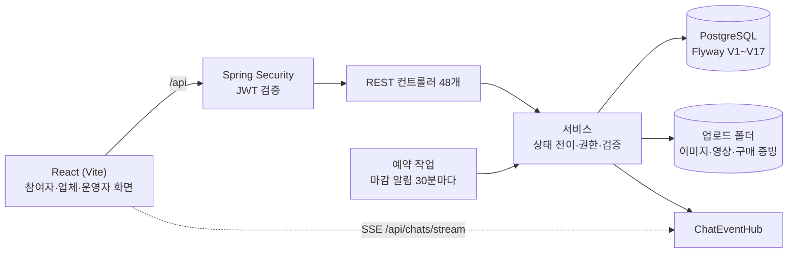
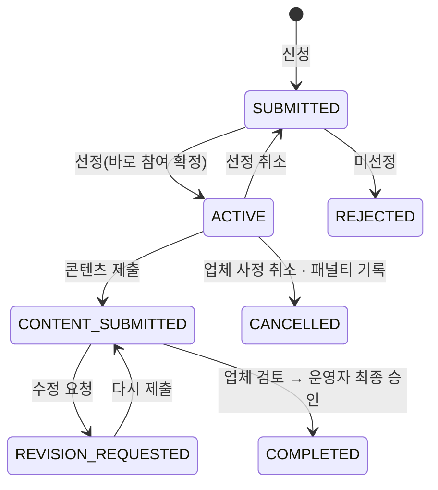

# MOVRIT

브랜드가 체험단·구매평 캠페인을 열고, 참여자가 신청부터 콘텐츠 제출까지 진행하고, 운영자가 마지막으로 검수하는 캠페인 운영 플랫폼입니다.
이 저장소는 Spring Boot 백엔드이고, 화면은 [movrit-frontend](https://github.com/yoo-jin-k/movrit-frontend)에 있습니다.

혼자 기획·설계·개발했고, 실제 체험단 사이트를 써 보면서 업체가 손으로 하던 일을 기능으로 옮기는 데 집중했습니다.

- 시연 영상(약 1분): [movrit-demo.mp4](https://github.com/yoo-jin-k/movrit-frontend/blob/developer/docs/demo/movrit-demo.mp4)
- 화면 모음: [movrit-frontend/docs/screenshots](https://github.com/yoo-jin-k/movrit-frontend/tree/developer/docs/screenshots)

| 참여자 · 내 캠페인 | 업체 · 참여자 관리 | 운영자 · 신고 처리 |
|---|---|---|
|  |  |  |

## 어떤 서비스인가

역할이 셋이고, 캠페인 하나가 세 사람 손을 차례로 거칩니다.

1. **업체**가 브랜드를 만들고 캠페인을 등록합니다. 캠페인마다 종류(제품·지역·구매평), 받는 방식(배송·방문·구매), 콘텐츠 채널, 일정, 신청서 질문, 참여 조건을 정합니다.
2. **참여자**가 신청서를 내고, 선정되면 제품을 받거나(배송) 매장에 가거나(방문) 직접 구매한 뒤(구매평) 콘텐츠 링크를 제출합니다.
3. 업체가 콘텐츠를 검토하고 **운영자**가 최종 승인하면 참여가 끝납니다.

이 사이에 필요한 운영 기능을 붙였습니다. 송장 입력과 배송지 엑셀, 방문 예약, 구매 인증과 환급, 브랜드와 참여자 사이 1:1 채팅, 마감 알림, 미제출·노쇼 패널티, 신고와 제재 같은 것들입니다.

## 기능

### 참여자

- 캠페인 탐색: 카테고리·지역·채널 필터, 마감 임박·인기·선정 확률 정렬, 검색. 거르기·정렬·페이지 나누기는 서버에서 합니다. 찜
- 신청: 캠페인별 질문과 필수 동의, 배송지 입력. 선정 전에는 신청 내용을 고칠 수 있습니다.
- 내 캠페인: 일정표(신청~결과 발표), 미션·제출 요건, 송장번호, 방문 예약, 구매 인증, 콘텐츠 제출과 수정 요청을 한 화면에서 처리
- 콘텐츠 성과: 올린 게시물의 조회수·좋아요·댓글 수를 날짜별로 남기고 지난 기록과 비교
- 활동 등급(완료 횟수에 따라 새싹~다이아), 패널티와 신청 제한 안내
- 채팅(사진 여러 장·영상 첨부, 읽음 표시, 입력 중 표시, 대화 검색), 커뮤니티, 알림
- 채널 연결과 지표 인증, 프로필·배송지·계정 설정, 탈퇴

### 업체

- 캠페인 등록·수정·복제, 대표 이미지와 상세 이미지, 방문 장소
- 참여자 관리: 채널 지표·완료 이력 확인, 여러 명 한 번에 선정·미선정, 선정 취소·복구, 완료 후 별점과 메모
- 배송 관리: 택배사·송장번호 입력, 선정자 배송지 엑셀(.xlsx) 내려받기
- 방문 예약 확정·반려, 구매 인증 확인과 환급 처리
- 콘텐츠 검토(완료·수정 요청), 캠페인별 콘텐츠 성과 합계와 참여율, 미제출·노쇼 패널티 기록

### 운영자

- 콘텐츠 최종 승인, 채널 지표 수동 확인
- 신고 처리(기각·경고·가리기·이용 정지), 신고 없이도 커뮤니티 글·댓글 바로 가리기·다시 보이기
- 운영 리포트: 기간 선택(최근 7·30·90일, 이번 달, 직접), 날짜별 추이, 엑셀 내려받기
- 패널티 취소, 마감 알림 수동 실행
- 회원·업체 심사·캠페인·참여자·공지·문의·리포트 관리. 연락처 같은 개인정보는 가려서 내려줍니다.

> 프리오더(공동구매)·주문·결제·정산 코드는 초기 기획 때 만든 것이 남아 있습니다. 조회와 상태 흐름만 있고 실제 결제사 연동은 하지 않았습니다.

## 기술 스택

| 구분 | 사용 |
|---|---|
| 언어·프레임워크 | Java 17, Spring Boot 4.1, Spring Security(JWT, OAuth2 Resource Server), Spring Data JPA |
| DB | PostgreSQL 18, Flyway(V1~V17) |
| 인증 | 이메일 + JWT(액세스·리프레시), Google·Kakao 로그인, 계정 연결 |
| 실시간 | SSE(채팅 메시지·읽음·입력 중·가림 이벤트) |
| 테스트·품질 | JUnit 5, Mockito, Spotless(google-java-format) |
| API 문서 | springdoc-openapi(Swagger UI), 메서드 Javadoc을 설명으로 사용 |
| 프론트엔드 | React 19, React Router 7, Vite 8 → [movrit-frontend](https://github.com/yoo-jin-k/movrit-frontend) |

규모(2026-11-03 기준): 컨트롤러 48개, API 273개, Java 파일 317개(약 2만 9천 줄), 테이블 67개, 외래 키 106개, 백엔드 테스트 182개.

## 구조



패키지는 기능 단위로 나누고, 그 안을 `controller / service / repository / entity / dto`로 나눴습니다.

| 영역 | 패키지 |
|---|---|
| 회원·인증 | `auth`, `member`, `memberavatar`, `memberaddress`, `emailverification`, `passwordreset`, `channelconnect` |
| 업체·브랜드 | `seller`, `brand` |
| 캠페인 | `collaboration`, `campaignmedia`, `campaigneligibility`, `campaignfavorite` |
| 참여 | `campaignapplication`, `campaigncontent`, `contentmetric`, `campaignshipping`, `purchasereview`, `participation` |
| 소통·운영 | `chat`, `community`, `notification`, `report`, `notice`, `inquiry`, `audit`, `admin` |
| 공통 | `common`(보안 설정, 파일 저장, 라이브러리 없이 만든 엑셀 작성기) |
| 프리오더(보존) | `product`, `preorder`, `order`, `payment`, `shipping`, `settlement` |

### 신청 상태



처음에는 선정 뒤에 참여자가 "참여 수락"을 한 번 더 누르는 단계(SELECTED)가 있었습니다. 실제 체험단 사이트는 선정이 곧 참여 확정이라 이 단계를 뺐습니다. 참여자가 스스로 취소하는 기능도 없앴습니다. 선정된 사람이 빠지면 업체가 다시 뽑아야 해서, 대신 업체 쪽에 선정 취소·복구를 두었습니다.

## 설계하면서 고민한 것

**모집 인원을 넘겨 선정되는 문제.** 업체 담당자 두 명이 동시에 선정하면 둘 다 "아직 자리가 있다"고 판단할 수 있었습니다. 선정할 때 캠페인 행을 `PESSIMISTIC_WRITE`로 잠근 뒤 인원을 세도록 바꿨고, 동시에 두 요청을 보내 한 건만 성공하는 것을 자동 점검으로 확인했습니다. 여러 명 일괄 선정도 한 건씩 같은 경로를 탑니다.

**보던 화면과 서버 내용이 다를 때.** 참여자가 신청서를 쓰는 동안 업체가 질문이나 참여 조건을 바꾸면 옛 조건으로 신청하게 됩니다. 신청서 양식과 참여 조건에 버전을 두고, 화면이 받은 버전과 서버 버전이 다르면 409로 돌려보내 다시 확인하게 했습니다. 콘텐츠 검토도 같은 방식이라 다른 사람의 검토 결과를 덮어쓰지 않습니다.

**나중에 바뀌는 원본.** 신청할 때의 배송지·답변·동의 버전·참여 조건을 신청서에 복사해 둡니다. 신고도 신고 당시 내용을 같이 저장해서, 작성자가 글을 지워도 운영자가 판단할 수 있습니다.

**개인정보가 보이는 시점.** 참여자 연락처와 주소는 선정된 참여자만 업체에 보이고, 배송지 엑셀에도 선정자만 들어갑니다. 운영자 API는 연락처를 `010-****-1234` 형태로 가립니다. 엑셀을 내려받으면 누가 언제 받았는지 감사 기록을 남깁니다.

**구매평 캠페인.** 제품을 보내 주는 협찬과 달리, 참여자가 먼저 결제하고 구매평이 승인되면 업체가 금액을 돌려주는 방식입니다. 받는 방식에 `PURCHASE`를 추가하고, 주문번호·결제 금액·주문 내역 사진을 받는 구매 인증과 환급 상태(대기·완료)를 따로 두었습니다. 구매형에는 "체험 완료 확인" 단계가 맞지 않아 그 요청은 409로 막았습니다.

**패널티와 신청 제한.** 콘텐츠 마감이 지났는데 제출하지 않았거나(미제출), 확정한 방문 일시가 지났는데 방문 확인이 없을 때(노쇼)만 업체가 기록할 수 있도록 조건을 서버에서 검사합니다. 90일 안에 유효한 패널티가 2건 쌓이면 마지막 패널티부터 30일 동안 새 신청을 막고, 잘못 기록된 패널티는 운영자가 취소할 수 있습니다.

**마감 알림은 한 번만.** 콘텐츠 마감 3일 전과 1일 전에 알림을 보내는 작업이 30분마다 돕니다. 서버를 다시 켜거나 작업이 겹쳐도 같은 알림이 두 번 가지 않도록 `(application_id, stage)` 유니크 키로 막았습니다.

**채팅.** WebSocket 대신 SSE를 골랐습니다. 보내기는 일반 POST로 충분하고 받기만 실시간이면 되는 구조라서입니다. 메시지·읽음·입력 중·운영자 가림 이벤트를 한 스트림으로 보내고, 25초마다 빈 이벤트를 보내 프록시가 연결을 끊지 않게 했습니다. 첨부 이미지는 확장자가 아니라 실제 내용을 읽어 JPEG·PNG인지 확인하고, 영상은 20MB까지 받습니다. 대화 검색어의 `%`, `_`는 이스케이프합니다.

**엑셀 내보내기.** 배송지 엑셀 하나 때문에 라이브러리를 들이기보다, xlsx가 zip 안의 XML이라는 점을 이용해 직접 만들었습니다(`SimpleXlsxWriter`). 처음에는 스타일 정의가 빠져 열 때 경고가 났고, `cellXfs`·`cellStyles`를 채운 뒤 LibreOffice와 openpyxl에서 정상적으로 열리는 것을 확인했습니다.

**콘텐츠 성과를 어디에 묶을지.** 처음에는 게시물 링크 행에 성과를 붙이려 했는데, 수정 요청 뒤 다시 제출하면 링크 행을 지우고 새로 만드는 구조라 기록이 같이 사라집니다. 그래서 성과는 (제출 건, 게시물 주소, 날짜)로 묶고, 같은 날 다시 입력하면 그 줄을 고치게 했습니다. SNS 지표를 자동으로 가져오지는 않습니다. 인스타그램·네이버는 공식 API 승인이 필요해서, 참여자나 업체가 확인한 숫자를 입력하는 방식으로 먼저 만들었습니다. 미래 날짜와 콘텐츠를 내기 전 날짜는 서버에서 막습니다.

**검색 쿼리의 null 날짜.** 캠페인 검색은 조건이 비어 있으면 거르지 않도록 `(:x is null or ...)` 형태로 썼습니다. 글자·enum 조건은 문제가 없었는데 '오늘 오픈' 날짜 조건만 PostgreSQL에서 `could not determine data type of parameter`로 500이 났습니다. 값이 null이면 드라이버가 타입을 알려 주지 않아서입니다. 단위 테스트(목 저장소)에서는 드러나지 않았고, 실제 서버에 붙인 점검에서 발견했습니다. 날짜는 null 대신 아주 이른 시각을 넘기도록 바꿨습니다.

**검색에서 무엇을 DB가, 무엇을 서버가 하나.** 검색어·종류·카테고리·지역·채널·프리미어 조건은 쿼리에서 거릅니다. 인기순·선정 확률순은 캠페인마다 신청 수가 있어야 해서, 거른 결과의 신청 수를 한 번의 집계 쿼리로 가져온 뒤 서버에서 정렬하고 페이지를 자릅니다. 지금 규모에서는 충분하고, 데이터가 커지면 신청 수를 캠페인 행에 따로 두는 쪽으로 바꿀 생각입니다.

**운영자가 가린 댓글.** 신고로 댓글을 가리면 예전에는 댓글을 지웠습니다. 그러면 잘못 가렸을 때 되돌릴 수가 없어서, 지우지 않고 `hidden` 표시만 하도록 바꿨습니다(V16). 회원 화면에는 자리만 남기고 "운영자가 가린 댓글입니다"로 보여 주고, 운영자 화면에서는 원문을 그대로 보고 다시 보이게 할 수 있습니다.

**읽기 전용 트랜잭션 안의 쓰기.** 엑셀 내보내기를 `readOnly` 트랜잭션으로 두었더니 감사 기록을 저장하다 500이 났습니다. 내려받기도 기록을 남기는 쓰기 작업이라 일반 트랜잭션으로 바꿨습니다.

**스키마 관리.** 처음에는 `ddl-auto`로 테이블을 만들어 PC마다 스키마가 달랐습니다. 그때 스키마를 V1 기준선으로 잡고, 이후 변경은 Flyway로만 합니다. JPA는 `validate`로 두어 엔티티와 테이블이 어긋나면 서버가 뜨지 않습니다. ERD는 [`docs/erd`](docs/erd/README.md)에 있습니다.

## 로컬 실행

필요한 것: JDK 17 이상, PostgreSQL 18, Node 24(프론트).

1. DB를 만듭니다. 이름은 `movrit_integration`, 사용자는 `movrit_user`입니다. 테이블은 서버가 처음 뜰 때 Flyway가 만듭니다.
2. `scripts/integration.env.example`을 저장소 상위 폴더에 `.movrit-integration.env`로 복사하고 값을 채웁니다. JWT 서명 키와 소셜 로그인 키가 들어가며 Git에는 올리지 않습니다.
3. 서버를 실행합니다.

```bash
scripts/integration.sh start     # http://localhost:18080 (jar가 없으면 빌드부터)
scripts/integration.sh restart   # 다시 빌드한 jar로 재시작
scripts/integration.sh logs      # build/run/backend.log
scripts/integration.sh stop
```

4. 프론트는 movrit-frontend에서 `npm run dev:integration` → http://localhost:5174

- JDK 17이 없으면 설치된 상위 버전으로 빌드합니다(`-PmovritJavaVersion=18` 등).
- 업로드 파일은 `~/.movrit/integration-uploads`에 저장됩니다.
- 메일 서버 없이도 가입할 수 있도록, 통합 환경에서는 인증번호를 메일 대신 화면에 보여 줍니다(`local-preview`). 실제 발송은 `EMAIL_DELIVERY=smtp`와 메일 계정 설정이 필요합니다.

### 시연 데이터

시연 계정과 캠페인 5개(배송형·방문형·구매평·클립·숙박)는 프론트 저장소의 스크립트가 실제 API를 호출해 만듭니다. 여러 번 실행해도 결과가 같습니다.

```bash
# movrit-frontend 에서
MOVRIT_QA_PASSWORD=... node qa/portfolio/seed-portfolio.mjs
```

| 역할 | 계정 |
|---|---|
| 업체 | `lumi.studio@movrit.local` (브랜드 루미 스킨랩·오월 키친·결 홈·머무름 스테이) |
| 참여자 | `haneul@`, `minji@`, `junho@movrit.local` |
| 운영자 | `demo-admin@movrit.local` |

비밀번호는 문서에 적지 않았습니다. 시연 순서는 [docs/portfolio/demo-scenario.md](docs/portfolio/demo-scenario.md)에 있습니다.

## API 문서

서버를 켜면 http://localhost:18080/swagger-ui.html 에서 전체 API를 보고 직접 호출해 볼 수 있습니다.

- 오른쪽 위 목록에서 **서비스 API**(공통·참여자·업체), **운영자 API**, **이전 기능**(프리오더·주문·결제) 중 하나를 고릅니다.
- `POST /api/auth/login`으로 로그인한 뒤 응답의 `accessToken`을 **Authorize**에 넣으면, 로그인이 필요한 API도 실행됩니다.
- 설명은 컨트롤러 메서드의 Javadoc 주석에서 자동으로 가져옵니다. 코드 주석과 문서가 따로 놀지 않게 하려고 이렇게 했습니다.
- 원본 JSON은 `/v3/api-docs/1-service`, `/v3/api-docs/2-admin`, `/v3/api-docs/3-legacy`입니다. 공개 서버에서 숨기려면 `API_DOCS_ENABLED=false`로 실행합니다.

## 테스트

```bash
./gradlew test spotlessCheck bootJar
./gradlew test -PmovritJavaVersion=18   # JDK 17이 없을 때
```

서비스 단위 테스트가 대부분입니다. 누가 언제 어떤 상태로 바꿀 수 있는지, 송장번호·택배사 검증, 패널티 조건, 신청 자격 검사를 주로 확인합니다. `MovritApplicationTests.contextLoads`는 기본 프로필 DB(`movrit`)에 접속하므로 그 DB도 최신 스키마여야 합니다.

화면을 거치는 흐름은 프론트 저장소의 Playwright 스크립트(`qa/e2e`)로 확인합니다. 신청 → 선정 → 배송 → 제출 → 승인, 구매평, 채팅, 신고 처리, 커뮤니티 관리, 리포트 엑셀, 콘텐츠 성과, 캠페인 검색 흐름을 실제 서버에 대고 돌립니다.

## 문서

- [구조 설명](docs/portfolio/architecture.md): 시스템 구성, 도메인별 책임, 상태 흐름, 결정 기록
- [시연 시나리오](docs/portfolio/demo-scenario.md): 약 10분 시연 순서
- [ERD](docs/erd/README.md), [DB 변경 이력](docs/db-migration.md)

## 남은 일

- 실제 메일 발송(SMTP), 인스타그램·네이버 개발자 앱 등록 후 SNS 로그인 연결
- SNS 공식 API로 콘텐츠 성과 자동 수집(지금은 직접 입력)
- 배포(HTTPS, 업로드 파일 S3 이전, CI)
