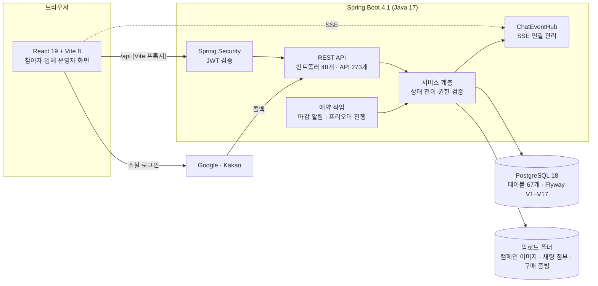
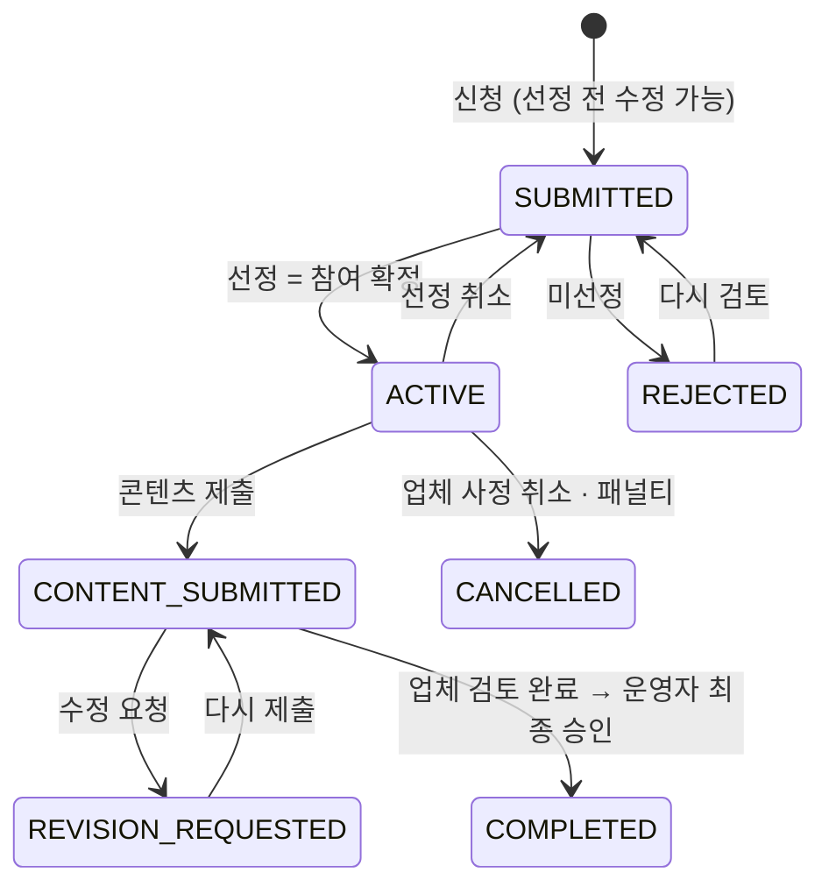

# MOVRIT 구조 설명

README가 "무엇을 만들었나"라면, 이 문서는 "어떻게 나눴고 왜 그렇게 했나"를 적은 것입니다.
수치는 2026-11-03 기준입니다.

## 1. 시스템 구성

| 구분 | 사용 |
|---|---|
| 프론트엔드 | React 19, React Router 7, Vite 8, Axios, Sass. 경로 92개, 첫 화면 외 지연 로딩 |
| 백엔드 | Spring Boot 4.1, Spring Security(JWT·OAuth2 Resource Server), Spring Data JPA, Lombok |
| DB | PostgreSQL 18, Flyway(이력 테이블 `movrit_schema_history`), JPA `validate` |
| API 문서 | springdoc-openapi(Swagger UI, /swagger-ui.html). 컨트롤러 Javadoc을 설명으로 사용, 서비스·운영자·이전 기능 그룹으로 나눔 |
| 품질 | 백엔드 테스트 182개(JUnit 5·Mockito), 프론트 단위 테스트 188개(node:test), Spotless, ESLint·Prettier, Playwright 화면 점검 17종 |

## 2. 패키지와 책임

기능마다 패키지를 두고 안에서 `controller / service / repository / entity / dto`로 나눴습니다. Java 파일 317개, 약 2만 9천 줄입니다.

| 영역 | 패키지 | 맡는 일 |
|---|---|---|
| 회원·인증 | `auth`, `member`, `memberavatar`, `memberaddress`, `emailverification`, `passwordreset`, `channelconnect` | 이메일·소셜 로그인과 계정 연결, 프로필 사진, 배송지, 이메일 인증, 비밀번호 재설정, SNS 채널 연결과 지표 |
| 업체 | `seller`, `brand` | 업체 신청·심사, 업체 하나가 여러 브랜드 운영 |
| 캠페인 | `collaboration`, `campaignmedia`, `campaigneligibility`, `campaignfavorite` | 캠페인 등록·분류·일정, 목록 검색·정렬·페이지, 이미지와 방문 장소, 참여 조건(채널 지표), 찜 |
| 참여 | `campaignapplication` | 신청서 양식, 신청·수정·선정·미선정·선정 편집, 일괄 처리 |
| | `campaigncontent` | 콘텐츠 제출, 업체 검토, 운영자 최종 승인, 수정 요청 |
| | `contentmetric` | 게시물별 조회수·좋아요·댓글 날짜별 기록, 캠페인 성과 합계 |
| | `campaignshipping` | 송장번호·택배사, 배송지 엑셀 |
| | `purchasereview` | 구매평 캠페인의 구매 정보, 구매 인증, 환급 |
| | `participation` | 활동 등급, 패널티와 신청 제한, 방문 예약, 참여자 평가, 마감 알림 |
| 소통 | `chat`, `community`, `notification` | 1:1 채팅(SSE), 게시판과 운영자 가리기·다시 보이기, 알림 |
| 운영 | `report`, `admin`, `notice`, `inquiry`, `audit` | 신고·제재, 운영자 조회 API, 기간별 운영 리포트·엑셀, 공지, 문의, 감사 기록 |
| 공통 | `common` | 보안 설정, 파일 저장, 엑셀 작성기(`common.excel`) |
| 프리오더(보존) | `product`, `preorder`, `order`, `payment`, `shipping`, `settlement` | 초기 기획의 공동구매 흐름. 실제 결제 연동 없이 상태 흐름만 |

새 기능은 되도록 새 패키지로 붙였습니다. 예를 들어 패널티·방문 예약·평가는 신청 서비스에 넣지 않고 `participation`으로 분리했고, 신청 서비스는 `ActivityService.requireCanApply` 한 줄만 부릅니다. 신청 서비스가 한때 974줄까지 커져서 양식·검사·응답 변환을 나눴던 경험 때문입니다.

## 3. 신청 상태 흐름

받는 방식에 따라 ACTIVE 안에서 하는 일이 다릅니다.

| 받는 방식 | ACTIVE 동안 | 업체 쪽 |
|---|---|---|
| 배송(DELIVERY) | 송장 확인 → 수령 후 체험 완료 확인 | 송장 입력, 배송지 엑셀 |
| 방문(VISIT) | 방문 예약 요청 → 확정 후 방문 → 체험 완료 확인 | 예약 확정·반려, 노쇼 기록 |
| 구매(PURCHASE) | 직접 구매 → 구매 인증(주문번호·금액·사진) | 인증 확인, 환급 처리 |

- 선정 주체는 캠페인마다 정합니다(업체 직접 `BRAND_DIRECT` / 운영자 `OPERATOR`). 신청이 하나라도 생기면 바꿀 수 없습니다.
- 상태가 바뀌면 상대방에게 알림을 보내고 감사 기록을 남깁니다.

## 4. 결정 기록

| 문제 | 결정 | 결과 |
|---|---|---|
| 캠페인이 프리오더에 1:1로 묶여, 공동구매가 없는 브랜드는 캠페인을 못 열었음 | 캠페인을 브랜드에 직접 소속시키고 프리오더 연결은 선택으로(V3) | 체험단만 운영하는 브랜드도 등록 가능 |
| 동시에 선정하면 모집 인원을 넘김 | 선정 시 캠페인 행 `PESSIMISTIC_WRITE` 잠금 후 인원 확인. 일괄 선정도 한 건씩 같은 경로 | 동시 2건 중 1건만 성공(자동 점검) |
| 신청서를 쓰는 사이 업체가 조건을 바꿈 | 양식·참여 조건·콘텐츠 검토에 버전을 두고, 다르면 409 | 옛 조건으로 신청되거나 남의 검토를 덮어쓰지 않음 |
| 신청 당시 내용이 나중 수정에 휘둘림 | 배송지·답변·동의·참여 조건을 신청서에 스냅샷 | 과거 기록 보존 |
| 선정 후 "참여 수락"을 한 번 더 받는 단계가 실제 서비스와 다름 | SELECTED 단계를 건너뛰고 선정 = ACTIVE. 참여자 자진 취소 대신 업체 선정 취소·복구 | 단계가 줄고, 빠진 자리를 업체가 바로 채움 |
| 업체에 연락처가 너무 일찍 보임 | 선정된 참여자만 연락처·주소 공개, 엑셀도 선정자만. 운영자 API는 가려서 응답 | 접수 단계 개인정보 보호 |
| 구매평은 협찬과 돈의 흐름이 반대 | 받는 방식 `PURCHASE`, 구매 정보·구매 인증·환급 상태를 별도 테이블로(V13) | 체험 확인 단계 없이 인증 → 환급으로 진행 |
| 미제출·노쇼를 업체가 마음대로 기록할 수 있음 | 마감 경과·예약 일시 경과 같은 조건을 서버에서 검사, 신청당 한 번(유니크) | 90일 2건이면 30일 신청 제한, 운영자 취소 가능 |
| 예약 작업이 겹치면 마감 알림이 두 번 감 | `(application_id, stage)` 유니크 키 | 재시작·중복 실행에도 한 번만 |
| 실시간 채팅에 WebSocket이 과함 | 보내기는 POST, 받기만 SSE. 25초마다 빈 이벤트 | 구현·디버깅이 단순, 프록시 타임아웃 회피 |
| 확장자만 바꾼 파일이 첨부됨 | ImageIO로 실제 내용을 읽어 JPEG·PNG 확인, 깨진 파일은 400 | 서버 500 대신 안내 메시지 |
| 신고된 글을 작성자가 지우면 판단 근거가 사라짐 | 신고할 때 대상 내용을 스냅샷, 같은 대상 신고 수 집계 | 원문이 없어도 처리 가능 |
| 배송지 엑셀 하나에 라이브러리가 큼 | zip + XML로 xlsx 직접 작성. 리포트용으로 여러 시트·숫자 칸을 더해 `common.excel`로 옮김 | 의존성 없이 배송지·운영 리포트 엑셀 |
| 신고로 가린 댓글을 되돌릴 수 없음(삭제했음) | 댓글에 `hidden` 표시(V16), 운영자 커뮤니티 관리 화면에서 가리기·다시 보이기 | 회원에게는 안내 문구, 운영자에게는 원문 |
| 재제출하면 링크 행이 새로 생겨 성과 기록이 끊김 | 성과를 (제출 건, 게시물 주소, 날짜)로 묶고 같은 날은 고쳐 씀(V17) | 재제출 뒤에도 같은 게시물 기록 유지 |
| 캠페인 목록을 전부 내려받아 화면에서 거름 | 서버 검색 API: 조건은 쿼리로, 신청 수가 필요한 정렬은 집계 뒤 서버에서, 20개씩 페이지 | 화면은 한 페이지만 받음 |
| 검색 쿼리의 null 날짜 파라미터가 PostgreSQL에서 500 | null 대신 아주 이른 시각을 넘김 | 실제 DB 점검으로 발견·수정 |
| 읽기 전용 트랜잭션에서 감사 기록 저장 실패(500) | 내려받기도 쓰기 작업으로 보고 일반 트랜잭션 | 내려받기 기록이 남음 |
| PC마다 스키마가 다름 | 그때 스키마를 V1 기준선으로, 이후 Flyway만. JPA `validate` | 어긋나면 서버가 뜨지 않아 바로 발견 |
| 메일 서버 없는 시연 환경 | 통합 환경에서는 인증번호를 화면에 표시(`local-preview`) | 메일 없이 가입·인증 시연 |
| 한 사람이 Google·Kakao로 따로 가입 | 계정 설정에서 소셜 계정 연결 | 한 계정으로 두 방식 로그인 |

## 5. 데이터 구조

- 테이블 67개, 외래 키 106개. 전체 ERD는 [`docs/erd/MOVRIT.dbml`](../erd/MOVRIT.dbml), 도메인별 그림은 [`docs/erd/`](../erd/README.md)에 있습니다.
- 변경 절차와 V1~V17 이력은 [`docs/db-migration.md`](../db-migration.md)를 따릅니다.

| 버전 | 내용 |
|---|---|
| V1~V2 | 기준선 스키마, 긴 문자열·금액 컬럼 확장 |
| V3~V5 | 캠페인의 브랜드 소속, 종류·지역·채널, 찜 |
| V6~V8 | 공지, SNS 채널 연결과 수동 확인 |
| V9~V12 | 채팅, 비밀번호 재설정, 커뮤니티, 채팅 첨부 |
| V13 | 구매평(구매 정보·구매 인증) |
| V14 | 마감 알림, 방문 예약, 패널티, 참여자 평가, 신고, 채팅 가림 |
| V15 | 캠페인 송장 |
| V16 | 커뮤니티 댓글 가림 표시, 글·댓글 가린 시각 |
| V17 | 콘텐츠 성과 기록 |
