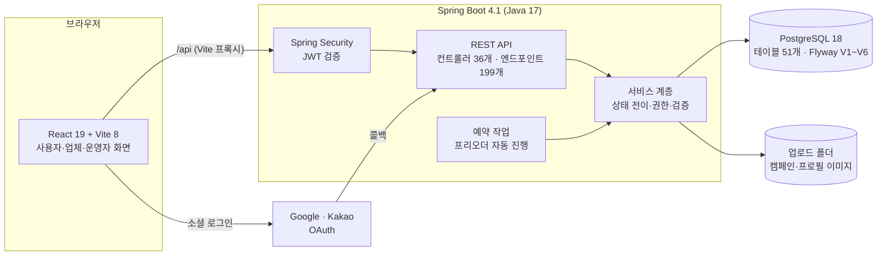
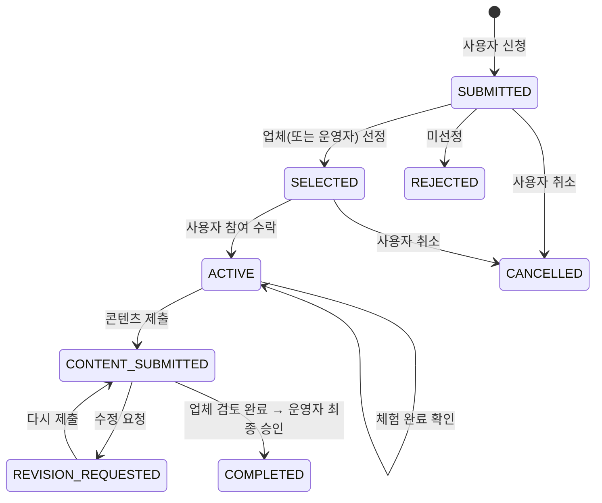

# MOVRIT 구조 설명

브랜드가 체험단 캠페인을 열고, 사용자가 신청 → 선정 → 체험 → 콘텐츠 제출 → 검토 → 완료까지 진행하는 플랫폼입니다.
이 문서는 시스템 구성, 기능 단위 구조, 그리고 설계하면서 내린 주요 결정을 설명합니다.

## 1. 시스템 구성

| 구분 | 기술 |
|---|---|
| 프론트엔드 | React 19, React Router 7, Vite 8, Axios, Sass (화면 경로 80개, 첫 화면 외 지연 로딩) |
| 백엔드 | Spring Boot 4.1, Spring Security(JWT·OAuth2 Resource Server), Spring Data JPA, Lombok |
| DB | PostgreSQL 18, Flyway(마이그레이션 이력 `movrit_schema_history`) |
| 품질 | 백엔드 테스트 117개(JUnit 5·Mockito), 프론트 테스트 131개(node:test), Spotless(google-java-format), ESLint·Prettier, Playwright 화면 자동 점검(`movrit-frontend/qa/e2e`) |

## 2. 백엔드 기능 단위 구조

기능마다 `controller / service / repository / entity / dto` 로 나눕니다(총 229개 파일, 약 1만 9천 줄).

| 영역 | 패키지 | 맡는 일 |
|---|---|---|
| 회원·인증 | `auth`, `member`, `memberavatar`, `memberaddress`, `emailverification` | 이메일·Google·Kakao 로그인, 계정 연결, 프로필 사진, 배송지, 이메일 인증 |
| 업체 | `seller`, `brand` | 업체 신청·승인, 브랜드 운영 |
| 캠페인 | `collaboration`, `campaignmedia`, `campaigneligibility`, `campaignfavorite` | 캠페인 등록·수정·분류, 이미지·방문 정보, 참여 조건(채널 지표), 찜 |
| 참여 | `campaignapplication`, `campaigncontent` | 신청서 양식, 신청·선정·참여 수락·체험 확인, 콘텐츠 제출·업체 검토·운영자 최종 승인 |
| 운영 | `admin`, `notice`, `audit`, `notification`, `inquiry` | 운영자 관리 화면 조회(회원·업체·리포트·설정 등), 공지사항, 감사 로그, 알림, 문의 |
| 프리오더(보존) | `product`, `preorder`, `order`, `payment`, `shipping`, `settlement` | 상품·재고, 프리오더, 주문·결제·배송·정산 |

## 3. 핵심 상태 흐름: 캠페인 신청

- 선정 주체는 캠페인마다 정합니다(업체 직접 선정 `BRAND_DIRECT` / 운영자 선정 `OPERATOR`). 신청 이력이 생기면 바꿀 수 없습니다.
- 상태가 바뀔 때마다 상대방에게 알림을 보내고 감사 로그를 남깁니다.

## 4. 설계하면서 내린 주요 결정

| 문제 | 결정 | 효과 |
|---|---|---|
| 캠페인이 프리오더에 1:1로 묶여 프리오더 없는 브랜드는 캠페인을 열 수 없었음 | 캠페인을 **브랜드에 직접 소속**시키고 프리오더 연결은 선택으로 변경(V3) | 체험단만 운영하는 브랜드도 캠페인 등록 가능 |
| 업체에 참여자 연락처가 너무 일찍 보임 | 참여자가 **참여를 수락(ACTIVE)한 뒤에만** 배송 연락처 공개 | 선정만 된 사용자의 개인정보 보호 |
| 신청 도중 업체가 조건을 바꾸면 다른 조건으로 신청될 수 있음 | 신청서·참여 조건·일정에 **버전**을 두고, 화면이 본 버전과 다르면 409 | 다른 화면의 변경을 덮어쓰지 않음 |
| 신청 당시 내용이 나중 수정에 영향받음 | 신청 시 배송 정보·답변·동의·참여 조건을 **신청서에 복사(스냅샷)** | 과거 신청 기록 보존 |
| 동시에 주문·찜이 몰리면 수량·중복이 어긋남 | 재고·프리오더 **쓰기 잠금**, 찜은 `ON CONFLICT DO NOTHING`, 주문·결제는 **요청 키(멱등성)** | 중복·초과 판매 방지 |
| 예약 작업이 결제 한 건 실패로 1분마다 같은 오류 반복 | 프리오더·결제 **건별 트랜잭션**으로 분리, 실패는 경고 한 번 | 한 건 실패가 전체를 멈추지 않음 |
| 두 DB의 스키마가 서로 달라짐 | **Flyway**로 V1 기준선 + 변경 이력 관리, ERD 자동 생성 스크립트 | 어느 PC에서도 같은 스키마 |
| 시연 환경에 메일 서버가 없음 | 통합 환경 전용 **로컬 미리보기 발송**(인증번호를 화면에 표시) | 메일 없이 회원가입·인증 시연 |
| 한 사람이 Google·Kakao로 따로 가입 | 계정 설정에서 **소셜 계정 연결** | 한 계정으로 두 방식 로그인 |
| 동시 선정으로 모집 인원을 넘길 수 있음 | 선정 시 캠페인 행을 **쓰기 잠금**한 뒤 인원을 세고 선정 | 동시 요청 2건 중 1건만 성공(자동 점검으로 확인) |
| 관리자 화면이 예시 데이터라 시연 신뢰도가 낮음 | 운영자 전용 **읽기 API**(`/api/admin/*`)를 따로 두고 개인정보는 가려서 응답 | 모든 관리자 화면이 실제 데이터, 연락처는 010-****-1234 |
| 신청 서비스가 974줄로 비대 | 양식·검사·응답 변환·JSON 도우미로 **역할 분리**(642줄) | 기능별로 읽고 고치기 쉬움 |

## 5. 데이터 구조

- 테이블 51개, 외래 키 77개. 전체 ERD는 [`docs/erd/MOVRIT.dbml`](../erd/MOVRIT.dbml), 도메인별 그림은 [`docs/erd/`](../erd/README.md)에 있습니다.
- DB 변경 절차와 V1~V6 이력은 [`docs/db-migration.md`](../db-migration.md)를 따릅니다.
